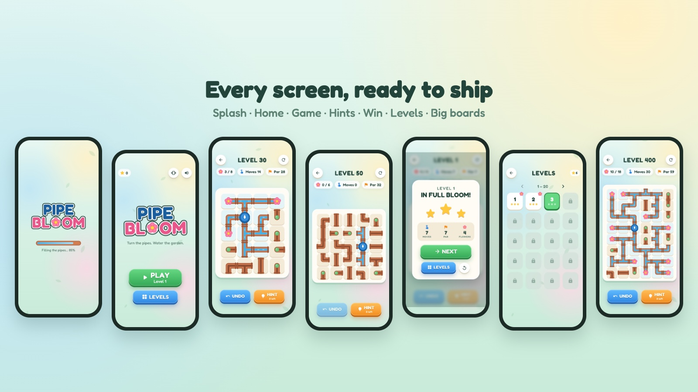

# Pipe Bloom – Flutter Pipe Puzzle Game

A relaxing pipe puzzle game made with Flutter. Tap the tiles to turn the pipes, lead the water from the well, and make every flower bloom.

**▶ Play the live demo:** https://yaqoobdeveloper.github.io/Pipe-Bloom-Puzzle-Game-in-Flutter/

**Get the full source code:** https://yaqoobdeveloper.com/ui-kits/pipe-bloom-flutter-pipe-puzzle-game

## Features

- 1000 levels, every one tested to be solvable
- Animated water flow and blooming flowers
- Moves, par and a 3-star rating
- Undo, plus 3 hints per level
- Saved progress, stars and settings
- Sound effects and haptics
- Android, iOS and web from one codebase

This repository holds the live demo only. The Flutter source code is available on yaqoobdeveloper.com.
